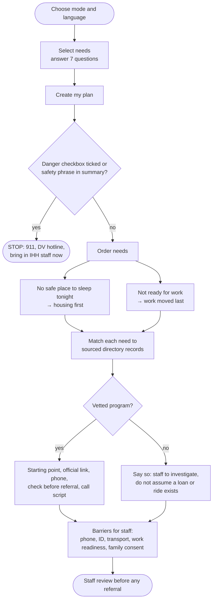
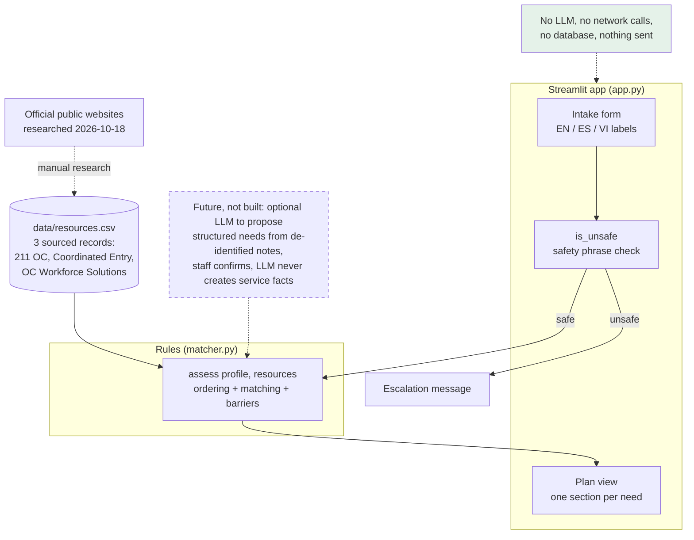

# Discharge Resource Navigator: architecture, workflow and safety

**Challenge 2: Finding the right resource.** For clients leaving recuperative care at Illumination
Health + Home (IHH), and the case managers helping them.

## 1. High level

A client about to leave recuperative care may need somewhere safe to sleep, work, a little money, or
a way home to family. The help exists in Orange County but is scattered, eligibility rules differ,
and a wrong phone number or a closed program costs a client a day they don't have.

Discharge Resource Navigator asks a few plain questions and returns a short, ordered plan: **housing
first** when there is nowhere safe to sleep, a sourced starting point for each need, what to check
before a referral, and what to say on the call. When it has no vetted program for a need, it says so
and hands it to staff instead of guessing.

| | |
|---|---|
| **Users** | Client (with staff nearby) or case manager |
| **Input** | Needs (shelter, work, small loan, return to family) and 7 yes/no/unknown questions; optional de-identified summary (case manager mode) |
| **Output** | Ordered next steps with source link, phone, "check before referral", call script, barriers for staff |
| **AI** | None at run time. Matching is deterministic, explainable Python rules |
| **Runs** | Streamlit on a laptop or GitHub Codespaces |

## 2. Workflow

## 3. Architecture

**Where AI is used, and where it isn't**

| Component | Technology | AI? |
|---|---|---|
| Ordering needs and matching resources | `matcher.assess`, deterministic Python rules | No |
| Safety check | Checkbox plus a fixed phrase list (`is_unsafe`) | No |
| Resource facts | Hand-researched CSV with source URL and verification date | No |
| Proposed future step | An LLM could extract *proposed* needs from de-identified notes for staff to confirm | Not built |

Keeping an LLM out of the run-time path was a deliberate choice: every recommendation can be traced
to a rule and a sourced record, and nothing can invent a phone number, an opening or an eligibility
rule.

## 4. How it was implemented

- **Stack:** Python, Streamlit for the UI, the standard `csv` module for data, pytest for tests.
- **Built during the event** in GitHub Codespaces, with no paid AI APIs. After the event, Claude
  (Claude Code) restored the complete app when `app.py` on main had been cut off, renamed it, and
  added tests that render the whole app.
- **Data:** three records researched from official public sites. Each carries the source URL,
  eligibility notes and a verification date. Phone numbers match the event's sourced directory.
- **Tests:** 6 pytest tests. Three test the rules (housing first, no invented program when none is
  vetted, danger detection). Three use Streamlit's `AppTest` to render the full app: the form, a
  housing-first plan with the "do not assume a loan or ride exists" warning, and the safety stop.
  GitHub Actions runs them on every push.

## 5. Governance and safety

| Risk | Control |
|---|---|
| Out-of-date or invented service facts | Only sourced records; source link and last-checked date shown on every step; "not live availability"; "check before referral" line; no program → explicit "staff to investigate" |
| Promising help that may not exist | Status "Potential starting point; eligibility and availability not confirmed"; family travel requires consent, destination, receiving person, safety and funding confirmed by staff |
| Client in danger | Safety stop replaces the plan with 911, National DV Hotline and "bring in IHH staff"; confidential shelter addresses never stored or shown |
| Privacy | No accounts, no database, no network calls, nothing sent to providers; on-screen warning not to enter names, DOB or medical details; summary field is de-identified only and is not sent to any AI |
| Over-trusting translation | Non-English users told that resource details and scripts remain in English and to ask for an interpreter |
| Human oversight | "Decision support only. Human review required before any discharge or placement decision." on every plan |
| Event rules | No connection to any IHH system; MIT license; open source |

**Known limits.** Only 3 resources: shelter navigation and work are covered, while small loans and
travel home show "no program" even though the event's directory has sourced programs for both. The
safety phrase list is short and is not a full safety screen. Translations cover labels only. Not
HIPAA-compliant and not approved for protected health information.
